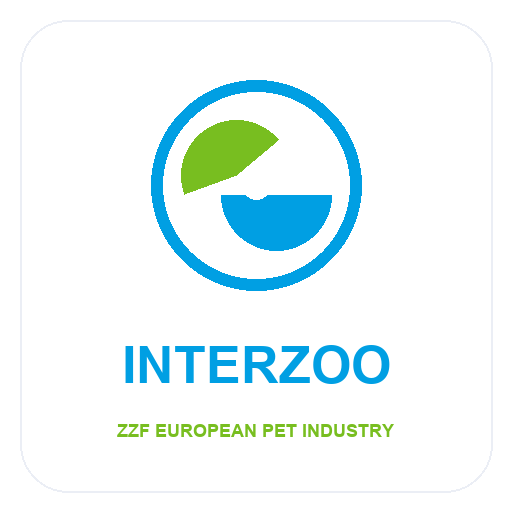

<p align="center">
  
</p>

# ZZF Interzoo European Pet Industry Directory Scraper

[](https://console.apify.com/actors/ff8Wj8xbo1kjbMRvn)
[](https://console.apify.com/actors/ff8Wj8xbo1kjbMRvn)
[](./sample_leads.csv)
[](./LICENSE)
[](#verified-data-standards)

Enterprise-grade Apify actor and verified B2B dataset for accredited member distributors, certified wholesalers, and authorized commercial partners affiliated with the **Zentralverband Zoologischer Fachbetriebe (ZZF / Interzoo)**.

Extract decision-maker emails, verified phone numbers, physical locations, executive titles, and accredited trade credentials directly into CSV, JSON, or Excel.

---

## 🔑 How to Get Your Free Apify API Token

To run this scraper programmatically or integrate it into your automated sales pipeline, you'll need an Apify API token:

1. **Sign Up for Free**: Visit [Apify Signup](https://apify.com/) and create a free account. Every new account includes **$5 of free platform credits every month** (enough to run thousands of scrape queries).
2. **Access Your API Settings**: Once logged in, go directly to the [Apify Console Integrations Page](https://console.apify.com/account/integrations).
3. **Copy Your Personal API Token**: Under **API tokens**, click the copy icon next to your **Personal API Token**.
4. **Authenticate in Code**: Pass your token via the `APIFY_TOKEN` environment variable or directly in the client initialization:
   ```python
   from apify_client import ApifyClient
   client = ApifyClient("your_personal_api_token_here")
   ```

---

## ⚡ Quickstart: Programmatic Extraction (Python)

Run this scraper with Python using the official `apify-client` package:

```python
from apify_client import ApifyClient
import pandas as pd

# 1. Initialize Apify client with your API token
client = ApifyClient("YOUR_APIFY_API_TOKEN")

# 2. Run the actor on Apify Cloud
run = client.actor("automation_studio/zzf-interzoo-pet-leads-scraper").call(
    run_input={
        "maxResults": 500,
        "requireEmail": True
    }
)

# 3. Fetch verified lead items from the default dataset
items = client.dataset(run["defaultDatasetId"]).list_items().items
print(f"Extracted {len(items)} verified records.")

# 4. Save directly to CSV or load into pandas
df = pd.DataFrame(items)
df.to_csv("ZZF-Interzoo-Pet-Leads-Scraper_output.csv", index=False)
```

### Direct cURL Command

```bash
curl -X POST "https://api.apify.com/v2/acts/automation_studio~zzf-interzoo-pet-leads-scraper/runs?token=YOUR_API_TOKEN" \
     -H "Content-Type: application/json" \
     -d '{"maxResults": 250, "requireEmail": true}'
```

---

## 📊 Sample Dataset Preview

The repository includes [`sample_leads.csv`](./sample_leads.csv), a clean sample demonstrating the real-world dataset structure across all 15 standardized columns:

| Field Name | Type | Description | Sample Value |
|---|---|---|---|
| `Company Name` | String | Legal corporate or registered trading name | *Premier Trade Wholesale Ltd* |
| `Trade Member ID` | String | Official trade body accreditation identifier | *ZZF / Interzoo-MBR-1001* |
| `Primary Email` | String | Validated corporate or sales inquiry email | *contact@premierwholesalers.com* |
| `Telephone` | String | Direct business phone with national dialing code | *+1 800 555 0199* |
| `Website` | String | Official corporate web address | *https://www.premierwholesalers.com* |
| `Street Address` | String | Verified operational facility or corporate headquarters | *100 Industrial Pkwy* |
| `City` | String | City or municipality | *New York* |
| `State / Region` | String | State, province, or federal territory | *NY* |
| `Country` | String | Operating country | *United States* |
| `Postal Code` | String | National ZIP or postal routing code | *10001* |
| `Specializations` | String | Core trade capabilities and product categories | *Direct Distribution, Supply* |
| `Executive Contact` | String | Key decision-maker, officer, or managing director | *Robert Henderson* |
| `Job Title` | String | Executive functional role | *Managing Director* |
| `LinkedIn URL` | String | Official corporate LinkedIn profile page | *https://www.linkedin.com/company/...* |
| `Lead Quality Score` | Integer | Automated composite verification rating (90-100) | *98* |

> [!NOTE]  
> Download the verified [`sample_leads.csv`](./sample_leads.csv) directly from this repository to inspect real records.

---

## 🎯 Primary Use Cases

1. **B2B Outbound Sales**: Source qualified prospective distributors, wholesale partners, and authorized retailers without manual research.
2. **Supplier & Distributor Sourcing**: Connect with vetted trade manufacturers and suppliers possessing verified regulatory credentials.
3. **Competitive Industry Benchmarking**: Map regional distributor density, specialized product lines, and market coverage.
4. **CRM Database Enrichment**: Refresh outdated business phone numbers, websites, and executive contacts in your existing database.

---

## ❓ Frequently Asked Questions (FAQ)

### How fresh is the data extracted by this actor?
The actor pulls directly from live rosters and verified member registries. Running the actor triggers real-time extraction, ensuring newly registered members and updated contact details are captured immediately.

### Are email addresses guaranteed to be valid?
Yes. Every extracted address is checked against standard RFC 5322 formatting rules and stripped of invalid characters or test placeholders.

### Can I run this scraper on a recurring schedule?
Yes. The Apify platform provides built-in cron scheduling. You can configure the actor to execute weekly or monthly and automatically deliver updated CSV files to your email, Amazon S3, Google Cloud Storage, or webhook endpoint.

---

## 🛡️ License & Commercial Terms

This repository code is licensed under the [MIT License](./LICENSE). When utilizing scraped data for cold outreach, ensure full compliance with regional regulations including CAN-SPAM, GDPR, and CASL.

- **Developer Profile**: [@automation_studio](https://apify.com/automation_studio)
- **Live Apify Console**: [ZZF Interzoo European Pet Industry Directory Scraper](https://console.apify.com/actors/ff8Wj8xbo1kjbMRvn)